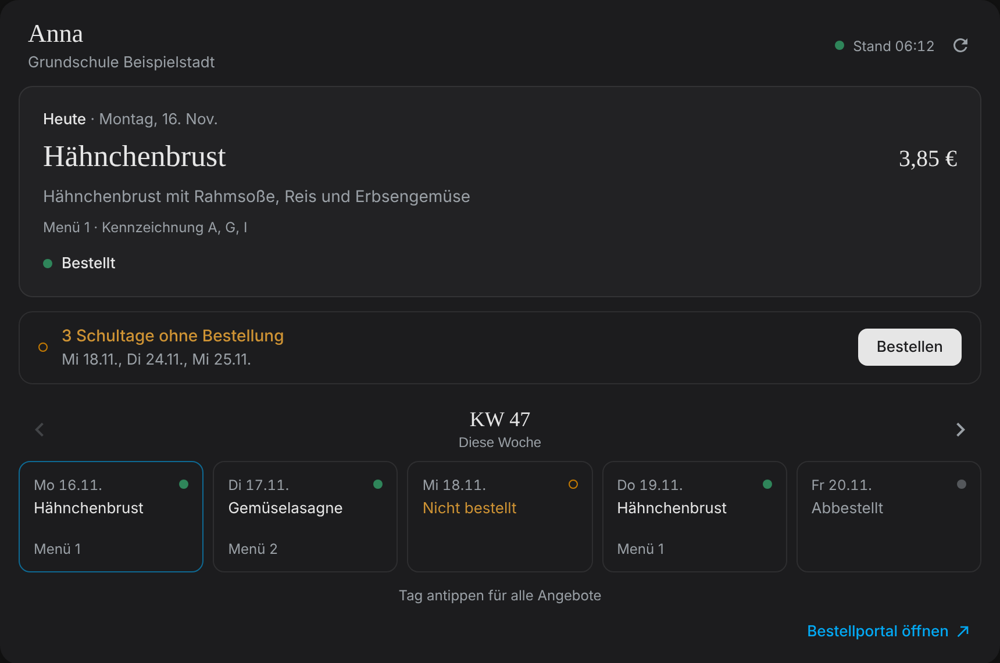
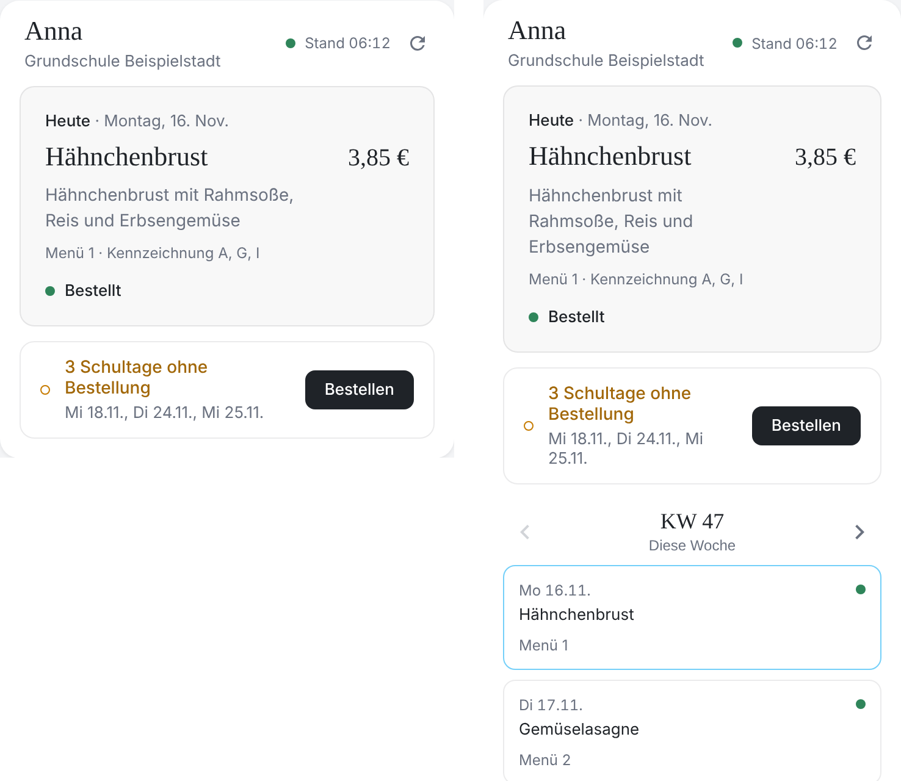

# Schulessen für Home Assistant

Zeigt den Speiseplan und den Bestellstatus aus dem Bestellportal der Schule in Home Assistant an und erinnert, wenn für die nächsten Tage noch nichts bestellt ist. Jedes Kind wird einzeln eingerichtet und kann ein anderes Portal haben. Die Integration liest nur das eigene Konto und bestellt nichts.

> Inoffizielles Privatprojekt, nicht verbunden mit Caterern, Portalbetreibern oder Schulträgern. Ob die Nutzung mit den AGB des eigenen Anbieters vereinbar ist, muss jeder selbst prüfen; die Verantwortung liegt beim Nutzer. Details in den [Nutzungsbedingungen](NUTZUNGSBEDINGUNGEN.md), denen bei der Einrichtung zugestimmt wird.

## Was man bekommt

Pro Kind:

- Sensoren `Essen heute`, `Essen morgen`, `Essen nächster Schultag` und `Essen Stand`
- einen Sensor `Nächster Bestellschluss` (Zeitstempel) und einen Binärsensor `Essen offen`, der an ist, solange im Erinnerungszeitraum ein Schultag ohne Bestellung liegt
- einen Kalender `Speiseplan` mit bestelltem Essen und allen Angeboten
- eine Bestell-Erinnerung per Benachrichtigung, täglich und auf Wunsch kurz vor Bestellschluss
- eine Karte für das Dashboard, auf Wunsch auch ein eigenes Dashboard „Schulessen“

Das Portal wird stündlich abgefragt. Ist es nicht erreichbar, bleiben die zuletzt geladenen Daten stehen. Ändert sich das Passwort, fragt Home Assistant nach dem neuen.

## Unterstützte Portale

Getestet sind diese beiden; bei der Einrichtung stehen sie als Vorlage zur Auswahl:

| Portal | Schnittstelle | Server | Realm / Mandant | Bestellseite |
|---|---|---|---|---|
| DLS „Guten APPetit!“ (SEB Schulessen Leipzig) | WAMP | `wss://connectanum.dls-gmbh.biz/wamp` | Realm `biz.dls` | `https://seb.dls-gmbh.biz/mein-essen` |
| GFB Catering Leipzig | REST | `https://proxy.mms-rcs.de` | Mandant `108106-gfb-leipzig` | `https://bestellung-gfb-catering.de` |

Andere Portale auf denselben Plattformen (weitere DLS-Standorte, Caterer mit „RCS-MMS Mobiler MenüService“) lassen sich mit eigenen Angaben einrichten. Die Mandanten-ID steht in `assets/enviroment.config.json` des jeweiligen Webportals. Wenn ein weiteres Portal funktioniert oder nicht, freue ich mich über ein Issue mit den Server-Angaben (ohne Zugangsdaten).

Die genannten Namen sind Marken ihrer Inhaber und stehen hier nur, um die Kompatibilität zu beschreiben.

## Installation

1. In Home Assistant unter Marketplace (oder HACS) das Repository `https://github.com/egohead/ha-schulessen` als Integration hinzufügen.
2. „Schulessen“ installieren und Home Assistant neu starten.
3. Unter Einstellungen → Geräte & Dienste die Integration „Schulessen“ hinzufügen.

## Einrichtung

Zuerst das Portal wählen, dann den Namen des Kindes und die Zugangsdaten eingeben. Bei den Vorlagen sind die Server-Angaben schon ausgefüllt. Optional lassen sich der Link zur Bestellseite und das Dashboard festlegen.

Für ein zweites Kind die Integration einfach noch einmal hinzufügen. Die Entitäten heißen nach dem Kind, also z. B. `sensor.anna_essen_heute`.

## Karte und Dashboard

Die Karte `custom:schulessen-card` kommt mit der Integration und wird automatisch geladen. Sie steht in der Kartenauswahl unter „Schulessen“ und lässt sich dort ohne YAML einstellen; Texte erscheinen je nach Spracheinstellung auf Deutsch oder Englisch. Sie zeigt das Essen für heute oder den nächsten Schultag, den Bestellschluss mit Restzeit, alle Tage ohne Bestellung samt Knopf zur Bestellseite und eine Wochenübersicht. Ein Tipp auf einen Tag zeigt alle Angebote.

| Hell | Dunkel |
|---|---|
|  |  |

Kompakt für die Übersicht und auf dem Smartphone:



Die Screenshots zeigen Beispieldaten.

Wer das Dashboard „Schulessen“ anlegen lässt, bekommt eine Übersicht mit einer kompakten Karte pro Kind und für jedes Kind eine eigene Seite mit Karte und Kalender. In andere Dashboards lässt sich die Karte so einbauen:

```yaml
type: custom:schulessen-card
entity: sensor.anna_essen_stand
variante: voll   # oder kompakt
```

## Erinnerung

Die Erinnerung wird unter Einstellungen → Geräte & Dienste → Schulessen → Konfigurieren eingeschaltet:

| Einstellung | Bedeutung |
|---|---|
| Uhrzeit | wann täglich geprüft wird, z. B. 17:00 |
| Zeitraum | wie viele Tage im Voraus (1 = nur morgen, bis 21); gilt auch für den Hinweis auf der Karte |
| Empfänger | ein oder mehrere `notify`-Dienste |
| Ferienkalender | optional; Tage mit Einträgen in diesem Kalender werden übersprungen |
| Vor Bestellschluss | optional, in Stunden; z. B. 3 = eine eigene Nachricht, wenn der Bestellschluss eines offenen Tages weniger als 3 Stunden entfernt ist |

Die tägliche Nachricht kommt nur, wenn im Zeitraum ein Schultag ohne Bestellung liegt und der Bestellschluss noch nicht vorbei ist. Die Nachricht vor Bestellschluss kommt pro Tag höchstens einmal. Mit der Schaltfläche „Essen-Erinnerung senden“ lässt sich das ausprobieren.

Wer lieber eigene Automationen baut, nimmt `binary_sensor.<kind>_essen_offen` oder `sensor.<kind>_nachster_bestellschluss` als Auslöser.

## Fehler melden

Unter Einstellungen → Geräte & Dienste → Schulessen → ⋮ → Diagnose herunterladen gibt es eine Datei, in der Zugangsdaten und Empfänger geschwärzt sind. Die bitte an ein Issue anhängen.

## Lizenz

MIT, siehe [LICENSE](LICENSE). Zusätzlich gelten die [Nutzungsbedingungen](NUTZUNGSBEDINGUNGEN.md).
