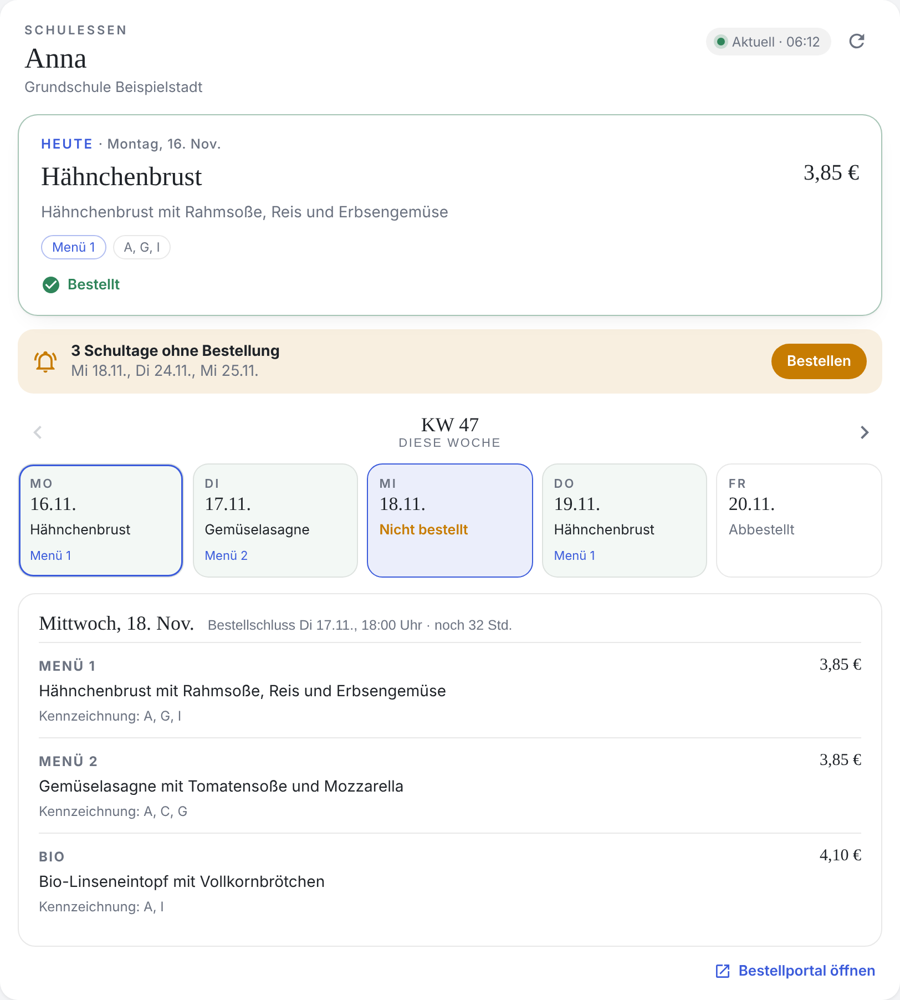
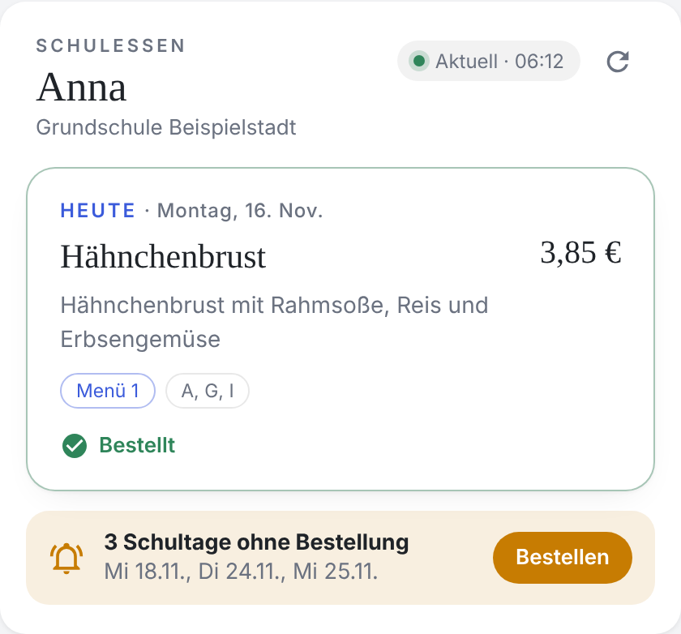
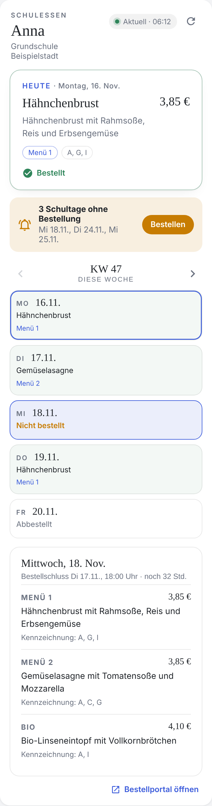

# Schulessen für Home Assistant

> **Wichtig – Nutzung auf eigene Verantwortung**
>
> Inoffizielles, unentgeltliches Privatprojekt ohne Verbindung zu Bestellportalen, Caterern oder Schulträgern. Ob die Nutzung mit dem Vertrag, den AGB und den Nutzungsbedingungen des eigenen Anbieters vereinbar ist, prüft und entscheidet **jede Nutzerin und jeder Nutzer selbst**. Die Verantwortung für Einsatz und Folgen liegt allein beim Nutzer. Es gelten die [Nutzungsbedingungen und der Haftungsausschluss](NUTZUNGSBEDINGUNGEN.md); ihnen wird bei der Einrichtung ausdrücklich zugestimmt.

Eine Integration für Schulessen-Bestellportale: Speiseplan, Bestellstatus, Bestellschluss und Erinnerungen – **pro Kind ein eigenes Portal**, ausgewählt aus Vorlagen. Liest nur das **eigene** Konto; es wird nichts bestellt.

## Funktionen

- **Mehrere Kinder, verschiedene Anbieter**: Jedes Kind wird einzeln eingerichtet und kann ein anderes Bestellportal haben.
- **Vorlagen** für bekannte Portale – Server-Angaben und Portal-Link werden automatisch eingetragen.
- **Sensoren** pro Kind: `Essen heute`, `Essen morgen`, `Essen nächster Schultag` (mit Liste der Tage ohne Bestellung), `Essen Stand`
- **Kalender** `Speiseplan` mit dem bestellten Essen und allen Angeboten
- **Bestell-Erinnerung** mit einstellbarer Uhrzeit, Zeitraum, Empfängern und Ferienkalender
- **Eigene Karte und optionales Dashboard** „Schulessen“
- Stündliche Abfrage mit **Zwischenspeicher**: Ist das Portal nicht erreichbar, bleiben die zuletzt geladenen Daten erhalten
- Re-Auth bei geändertem Passwort; nur lesend

## Unterstützte Bestellportale

Getestet. Diese Angaben stehen bei der Einrichtung als **Vorlage** zur Auswahl:

| Anbieter / Portal | Schnittstelle | Server | Realm / Mandant | Link zum Bestellportal |
|---|---|---|---|---|
| DLS „Guten APPetit!“ – SEB Schulessen Leipzig | WAMP | `wss://connectanum.dls-gmbh.biz/wamp` | Realm `biz.dls` | `https://seb.dls-gmbh.biz/mein-essen` |
| GFB Catering Leipzig | REST | `https://proxy.mms-rcs.de` | Mandant `108106-gfb-leipzig` | `https://bestellung-gfb-catering.de` |

Weitere Portale derselben Plattformen lassen sich über „Anderes Portal mit WAMP-/REST-Schnittstelle“ mit eigenen Angaben einrichten (z. B. andere DLS-Standorte oder Caterer mit „RCS-MMS Mobiler MenüService“; die Mandanten-ID steht in `assets/enviroment.config.json` des Webportals). Ungetestete Portale gern als Issue melden – mit Server-Angaben, ohne Zugangsdaten.

Die genannten Namen sind Marken bzw. Unternehmenskennzeichen ihrer jeweiligen Inhaber und dienen hier nur der Beschreibung der Kompatibilität.

## Installation

1. Home Assistant → Marketplace (bzw. HACS) → **Über Link hinzufügen** / *Benutzerdefinierte Repositories*: `https://github.com/egohead/ha-schulessen`, Typ **Integration**
2. „Schulessen“ installieren und Home Assistant neu starten
3. Einstellungen → Geräte & Dienste → Integration hinzufügen → „Schulessen“

## Einrichtung

1. **Bestellportal wählen** – Vorlage oder „Anderes Portal …“
2. **Kind und Zugangsdaten** – Name des Kindes, Benutzername/Kundennummer, Passwort; Server-Angaben sind bei Vorlagen vorausgefüllt
3. Optional: Link zum Bestellportal, Dashboard anlegen
4. Zustimmung zu den Nutzungsbedingungen (Pflicht)

Für ein weiteres Kind die Integration erneut hinzufügen. Die Entitäten heißen nach dem Kind, z. B. `sensor.anna_essen_heute`.

### Umstieg von den früheren Einzel-Integrationen

Wer bisher „Schulessen (WAMP-Bestellportal)“ oder „Schulessen (REST-Bestellportal)“ nutzt: Nach der Installation von „Schulessen“ und einem Neustart werden die vorhandenen Einträge samt Zugangsdaten und Einstellungen automatisch übernommen. Danach die alten Integrationen entfernen.

## Dashboard und Karte

Bei der Einrichtung kann optional ein eigenes Dashboard **„Schulessen“** angelegt werden. Es enthält:

- eine **Übersicht** mit einer kompakten Karte pro Kind (mehrere Kinder),
- pro Kind eine **eigene Ansicht** mit der vollständigen Karte und einem Kalender.

Die Karte `custom:schulessen-card` wird mit der Integration ausgeliefert und automatisch geladen – keine zusätzliche Installation nötig. Sie zeigt:

- das bestellte Essen für heute bzw. den nächsten Schultag mit Beschreibung, Menülinie, Kennzeichnung und Preis,
- den Bestellstatus und den Bestellschluss mit Restzeit,
- einen Hinweis auf alle Schultage ohne Bestellung, mit Knopf zum Bestellportal,
- eine Wochenübersicht (diese und die folgenden Wochen); ein Tag antippen zeigt alle Angebote,
- Live-/Zwischenspeicher-Status und eine Schaltfläche zum sofortigen Aktualisieren.

| Hell | Dunkel |
|---|---|
|  |  |

| Kompakt (Übersicht) | Smartphone |
|---|---|
|  |  |

*Beispieldaten.*

Die Karte lässt sich auch in jedes andere Dashboard einfügen:

```yaml
type: custom:schulessen-card
entity: sensor.anna_essen_stand   # Stand-Sensor der Integration
variante: voll                    # oder: kompakt
```

Dashboard und Bestellportal-Link lassen sich später unter *Einstellungen → Geräte & Dienste → Integration → Konfigurieren* ändern; dort kann die Ansicht auch neu angelegt werden.

## Bestell-Erinnerung

Unter *Einstellungen → Geräte & Dienste → Integration → Konfigurieren* lässt sich eine Erinnerung einschalten:

| Einstellung | Bedeutung |
|---|---|
| Uhrzeit | wann täglich geprüft wird, z. B. 17:00 |
| Zeitraum | wie viele Tage voraus geprüft wird: 1 = morgen, 3, 7, 14 … (gilt auch für den Hinweis in der Karte) |
| Empfänger | ein oder mehrere Benachrichtigungsdienste, z. B. `notify.mobile_app_iphone` |
| Ferienkalender | optional; Tage mit Terminen in diesem Kalender werden übersprungen |

Benachrichtigt wird nur, wenn im Zeitraum Schultage ohne Bestellung liegen, deren Bestellschluss noch nicht vorbei ist. Die Nachricht enthält einen Knopf zum Bestellportal. Mit der Schaltfläche **„Essen-Erinnerung senden“** lässt sich das testen.

## Rechtliche Hinweise

Siehe [Nutzungsbedingungen und Haftungsausschluss](NUTZUNGSBEDINGUNGEN.md). Es werden keine Logos oder Inhalte Dritter mitgeliefert.

## Lizenz

MIT, siehe [LICENSE](LICENSE). Ergänzend gelten die [Nutzungsbedingungen](NUTZUNGSBEDINGUNGEN.md).
